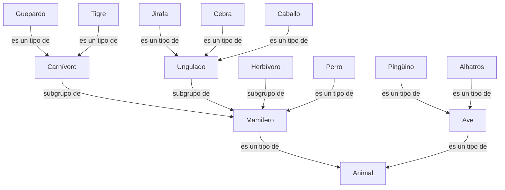

# Ontología

Esta ontología representa los **conceptos, características, instancias y vínculos** empleados en las notas ficticias de Ana Torres y las entrevistas que hicimos en la actividad pasada

## 1. Diagrama de clases y categorías

Las flechas con el texto son relaciones entre los conceptos.

## 2. Instancias y propiedades que tenemos

| Instancia | Propiedades iniciales | Clasificación |
|---|---|---|
| perro | TienePelo, DaLeche, CuatroPatas, ExcelenteOlfato, Ladra, Domesticado | Mamífero, Perro |
| caballo | DaLeche, TienePezuñas, TieneCrin, TieneColaLarga, TienenOrejasErgidas, NoConsumeCarne | Mamífero, Ungulado, Herbívoro, Caballo |
| guepardo | TienePelo, ComeCarne, Leonado, ManchasOscuras | Mamífero, Carnívoro, Guepardo |
| tigre | TienePelo, ComeCarne, RayasNegras | Mamífero, Carnívoro, Tigre |
| jirafa | TienePelo, TienePezuñas, CuelloLargo, ManchasOscuras | Mamífero, Ungulado, Jirafa |
| cebra | TienePelo, TienePezuñas, RayasNegras | Mamífero, Ungulado, Cebra |
| pingüino | TienePlumas, Nada, BlancoYNegro | Ave, Pingüino |
| albatros | TienePlumas, VuelaMuyBien | Ave, Albatros |

## 3. Relaciones y reglas

Todas las reglas siguen el patrón **SI predicado, ENTONCES conclusión**.

| Nº | Predicados | Conclusión |
|---:|---|---|
| 1 | TienePelo(x) | Mamífero(x) |
| 2 | DaLeche(x) | Mamífero(x) |
| 3 | TienePlumas(x) | Ave(x) |
| 4 | Vuela(x) ∧ PoneHuevos(x) | Ave(x) |
| 5 | ComeCarne(x) ∧ Mamífero(x) | Carnívoro(x) |
| 6 | TienePezuñas(x) ∧ Mamífero(x) | Ungulado(x) |
| 7 | Carnívoro(x) ∧ Leonado(x) ∧ ManchasOscuras(x) | Guepardo(x) |
| 8 | Carnívoro(x) ∧ RayasNegras(x) | Tigre(x) |
| 9 | Ungulado(x) ∧ CuelloLargo(x) ∧ ManchasOscuras(x) | Jirafa(x) |
| 10 | Ungulado(x) ∧ RayasNegras(x) | Cebra(x) |
| 11 | Ave(x) ∧ Nada(x) ∧ BlancoYNegro(x) | Pingüino(x) |
| 12 | Ave(x) ∧ VuelaMuyBien(x) | Albatros(x) |
| 13 | Mamífero(x) ∧ CuatroPatas(x) ∧ TienePelo(x) ∧ ExcelenteOlfato(x) | Perro(x) |
| 14 | Mamífero(x) ∧ Ladra(x) ∧ Domesticado(x) | Perro(x) |
| 15 | Mamífero(x) ∧ TieneCrin(x) ∧ TieneColaLarga(x) ∧ TienenOrejasErgidas(x) ∧ TienePezuñas(x) | Caballo(x) |
| 16 | Mamífero(x) ∧ NoConsumeCarne(x) | Herbívoro(x) |
